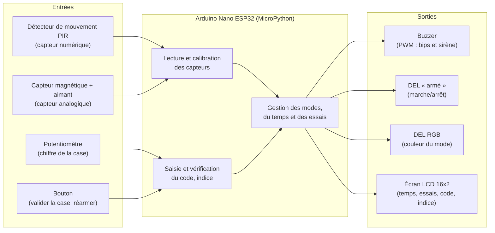
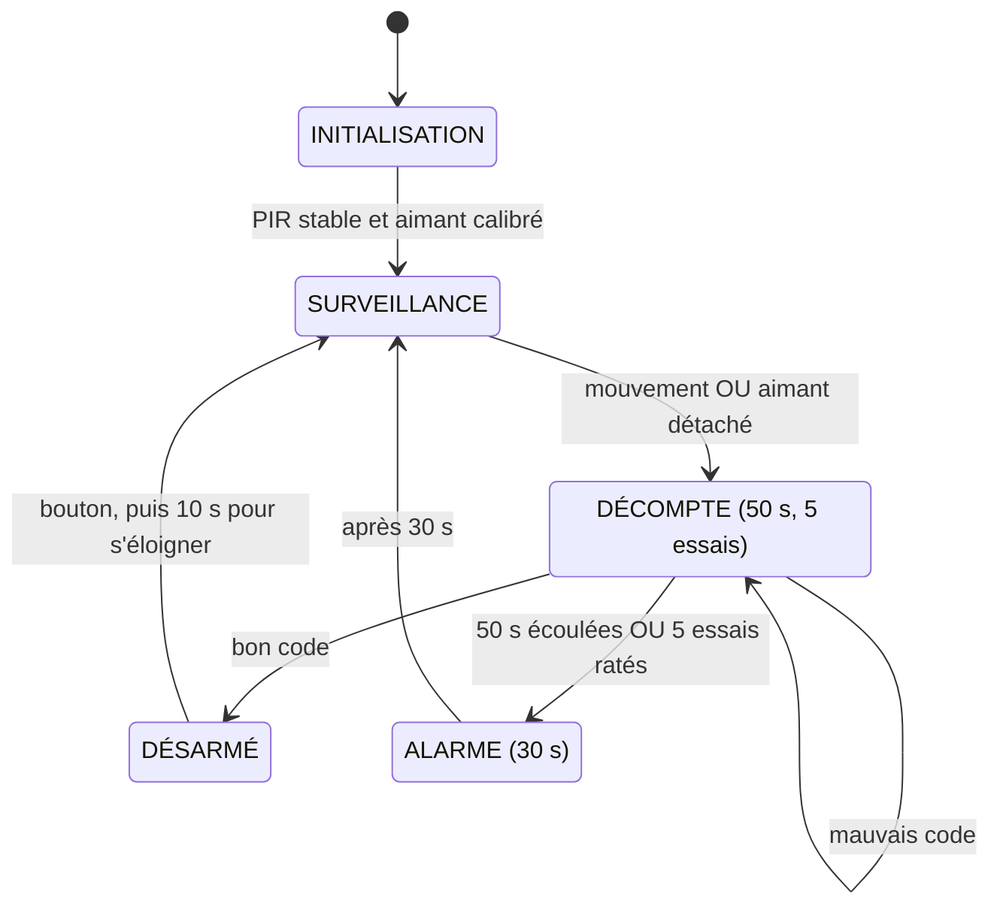

# Détecteur de mouvement à code

- **Cours :** 420-314 Plateformes embarquées, automne 2026
- **Épreuve finale :** Système embarqué interactif
- **Livrable 1 :** choix de projet et plan de projet
- **Équipe :** Wassim et Hussein
- **Date :** 25 novembre 2026
- **Dépôt GitHub :** <https://github.com/Wassim087/detecteur-de-mouvement>

---

## Ce que l'énoncé demande pour le livrable 1

> - Description du problème choisi et de la fonction du prototype.
> - Diagramme fonctionnel du système.
> - Liste préliminaire des composants.
> - Attribution préliminaire des broches.
> - Répartition initiale du travail entre les deux membres de l'équipe.
> - Lien du dépôt GitHub de l'équipe, transmis à la personne enseignante.

| Élément demandé | Où le trouver |
|---|---|
| Description du problème et de la fonction du prototype | Section 1 |
| Diagramme fonctionnel du système | Section 2 |
| Liste préliminaire des composants | Section 3 |
| Attribution préliminaire des broches | Section 4 |
| Répartition initiale du travail | Section 5 |
| Lien du dépôt GitHub | Section 6 |

La section 7 montre comment le projet respecte les exigences de l'énoncé.

---

## 1. Description du problème choisi et de la fonction du prototype

**Problème :** quand on n'est pas là, on veut savoir si quelqu'un entre dans une pièce ou ouvre une porte. On veut aussi empêcher qu'un intrus puisse arrêter l'alarme facilement.

**Fonction du prototype :** le système surveille la pièce avec un détecteur de mouvement et un aimant placé sur la porte. Dès qu'il détecte un mouvement ou que l'aimant se détache, le buzzer se met à sonner. Pour l'arrêter, la personne doit entrer le bon code à 4 chiffres en moins de 50 secondes, avec 5 essais au maximum. L'écran affiche le temps et le nombre d'essais qui restent, ainsi qu'un indice après chaque essai raté. Si le temps est écoulé ou si les 5 essais sont ratés, l'alarme se déclenche.

### Scénario

1. **Initialisation :** au démarrage, le détecteur de mouvement se stabilise. Le système mesure le capteur magnétique quand l'aimant est collé à la porte. Cette mesure sert de référence (calibration).
2. **Surveillance :** la DEL « armé » est allumée et la DEL RGB est bleue.
3. **Détection :** un mouvement **ou** un aimant détaché lance le **décompte**. Le buzzer bipe tout de suite. La personne a **50 secondes** et **5 essais** pour entrer le code.
4. **Saisie du code :** on tourne le potentiomètre pour choisir le chiffre de la case (de 0 à 9). On appuie sur le bouton pour valider ce chiffre et passer à la case suivante. Après les 4 cases, le code est vérifié.
5. **Mauvais code :** le buzzer fait un bip plus grave, il reste un essai de moins et un indice s'affiche pour chaque chiffre : `+` (le bon chiffre est plus grand), `-` (il est plus petit) ou `=` (il est bon).
6. **Bon code :** le buzzer se tait et le système est **désarmé**. La DEL RGB devient verte. Un appui sur le bouton réarme le système, avec 10 secondes pour s'éloigner.
7. **Temps écoulé ou 5 essais ratés :** c'est l'**alarme**. Le buzzer joue une sirène et la DEL RGB clignote en rouge. Après 30 secondes, le système revient seul en surveillance, sans redémarrer la carte.

### Ce que montre l'écran LCD 16x2

Pendant le décompte, **le temps qui reste** (de 50 à 0 secondes, mis à jour chaque seconde) et **le nombre d'essais qui restent** (de 5 à 0) sont toujours affichés.

| Mode | Ligne 1 | Ligne 2 |
|---|---|---|
| Initialisation | `Demarrage...` | |
| Surveillance | `Surveillance` | |
| Décompte | `T:42s  Essais:3` | `Code:47[5]_ +-=+` |
| Alarme | `ALARME` | `Fin dans 25s` |
| Désarmé | `Desarme` | `Bouton = armer` |

Dans l'exemple du décompte, il reste 42 secondes et 3 essais. Les chiffres 4 et 7 sont validés, la case active (entre crochets) affiche 5 et `+-=+` est l'indice de l'essai précédent. L'écran n'affiche pas les accents, car son jeu de caractères ne les contient pas.

### Sorties selon le mode

| Mode | DEL « armé » | DEL RGB | Buzzer |
|---|---|---|---|
| Initialisation | éteinte | blanche | muet |
| Surveillance | allumée | bleue | muet |
| Décompte | allumée | jaune | bips d'avertissement, bip grave à chaque mauvais code |
| Alarme | allumée | rouge clignotante | sirène |
| Désarmé | éteinte | verte | muet |

---

## 2. Diagramme fonctionnel du système

### Modes de fonctionnement

---

## 3. Liste préliminaire des composants

| Composant | Qté | Rôle | Type |
|---|---|---|---|
| Arduino Nano ESP32 | 1 | Microcontrôleur | — |
| Détecteur de mouvement PIR | 1 | Détecter une présence dans la pièce | Capteur numérique |
| Capteur magnétique et aimant | 1 | Détecter l'ouverture de la porte | Capteur analogique |
| Potentiomètre | 1 | Choisir le chiffre de la case | Interaction (entrée analogique) |
| Bouton | 1 | Valider la case, réarmer | Interaction (entrée numérique) |
| Buzzer | 1 | Bips d'avertissement et sirène | Sortie PWM |
| DEL (avec sa résistance) | 1 | Indiquer que le système est armé | Sortie numérique |
| DEL RGB (avec ses résistances) | 1 | Montrer le mode par une couleur | Sortie |
| Écran LCD 16x2 avec adaptateur I2C | 1 | Afficher le temps, les essais, le code et l'indice | Composant nouveau |
| Plaquette d'essai et fils | — | Montage | — |
| Matériaux de la maquette | — | Pièce, porte et boîtier d'alarme | — |

---

## 4. Attribution préliminaire des broches

| Pièce | Broche | GPIO | Raison |
|---|---|---|---|
| DEL RGB (rouge, vert, bleu) | D2, D3, D4 | 5, 6, 7 | Mêmes broches qu'au chapitre 4 du cours |
| Détecteur de mouvement PIR | D5 | 8 | Entrée numérique |
| Bouton | D6 | 9 | Entrée numérique |
| Buzzer | D7 | 10 | Sortie PWM |
| DEL « armé » | D8 | 17 | Sortie numérique |
| Potentiomètre | A0 | 1 | Entrée analogique, même broche qu'au chapitre 7 |
| Capteur magnétique | A1 | 2 | Entrée analogique |
| Écran LCD (SDA, SCL) | A4, A5 | 11, 12 | Bus I2C, mêmes broches que la matrice du chapitre 9 |
| Alimentation | 3V3, VBUS (5 V), GND | — | Le PIR et l'écran peuvent demander 5 V |

**À vérifier au livrable 2 :**

- Un écran LCD fonctionne souvent en 5 V, alors que les broches de l'ESP32 acceptent seulement 3,3 V. Nous lirons la fiche technique de l'écran et de son adaptateur I2C avant de le brancher.
- Si l'écran n'a pas d'adaptateur I2C, il demandera 6 broches de plus et ce tableau sera ajusté.
- Le modèle exact du détecteur de mouvement et du capteur magnétique (tension d'alimentation, type de sortie).

---

## 5. Répartition initiale du travail entre les deux membres de l'équipe

| Tâche | Responsable |
|---|---|
| Saisie du code : potentiomètre, bouton, vérification et indice | Wassim |
| Écran LCD (composant nouveau) | Wassim |
| Capteurs : détecteur de mouvement, capteur magnétique et calibration | Hussein |
| Sorties : buzzer, DEL et DEL RGB | Hussein |
| Gestion des modes, du temps et des essais | Ensemble |
| Maquette, README et vidéo | Ensemble |

Chaque membre doit pouvoir expliquer tout le projet, pas seulement sa partie. Chacun fait ses propres envois (push) dans le dépôt GitHub.

---

## 6. Lien du dépôt GitHub de l'équipe

<https://github.com/Wassim087/detecteur-de-mouvement>

Le lien est transmis à la personne enseignante le 25 novembre 2026.

---

## 7. Respect des exigences de l'énoncé

### Exigences techniques obligatoires (section 2 de l'énoncé)

| Exigence | Critère minimal (énoncé) | Notre projet |
|---|---|---|
| Plateforme | Arduino Nano ESP32 (ABX00083), programmé en Python/MicroPython selon l'environnement utilisé dans le cours. | Arduino Nano ESP32 programmé en MicroPython. |
| Deux capteurs au minimum | Au moins un capteur à sortie analogique et un capteur à sortie numérique. Ils doivent mesurer deux phénomènes ou états pertinents pour le projet. | Capteur numérique : détecteur de mouvement (présence). Capteur analogique : capteur magnétique (porte ouverte ou fermée). |
| Deux actionneurs ou sorties au minimum | Au moins une sortie commandée de façon analogique ou graduelle, normalement par PWM, et une sortie numérique de type marche/arrêt. | Sortie PWM : buzzer (la fréquence change pour les bips et la sirène). Sortie marche/arrêt : DEL « armé ». |
| Composant nouveau et substantiel | Intégrer au moins un composant qui n'a jamais été utilisé en classe et qui exige un réel travail d'intégration. Exemples : écran LCD/OLED, module à protocole I2C inédit, matrice de DEL, lecteur RFID/NFC, capteur environnemental combiné, clavier matriciel ou module semblable. Une simple DEL, résistance ou bouton ne suffit pas. | Écran LCD 16x2 : il affiche le temps, les essais, le code en cours et l'indice. |
| Réaction intelligente | Les sorties doivent dépendre de l'interprétation des données des capteurs. Le système doit comporter au moins deux états ou modes de fonctionnement et ne peut pas se limiter à recopier directement une entrée vers une sortie. | 5 modes (initialisation, surveillance, décompte, alarme, désarmé). Les sorties dépendent du mode, du temps qui reste, des essais et de la comparaison du capteur magnétique avec sa référence. |
| Signaux perceptibles | Le prototype doit communiquer son état à une personne par au moins deux formes de rétroaction parmi : lumière, son, affichage, mouvement ou autre sortie clairement perceptible. | Son (buzzer), lumière (DEL et DEL RGB) et affichage (écran LCD). |
| Fonctionnement autonome | Après le démarrage, le scénario principal doit fonctionner sans modification manuelle du code ni intervention dans l'environnement de développement. | Le programme démarre seul (`main.py`). L'alarme revient seule en surveillance après 30 secondes. |
| Maquette esthétique | Le produit final doit être esthétique et prendre la forme d'une véritable maquette (boîtier, structure ou objet reproduisant le produit visé), et non des composants disposés pêle-mêle sur une table. Exemple : un jeu de Snake intégré dans une petite console ou une manette de jeu. Le prototype doit ressembler à un produit fini et présentable. | Une petite pièce avec une porte : l'aimant est sur la porte et le capteur magnétique sur le cadre. Le boîtier d'alarme (écran, potentiomètre, bouton, DEL) est fixé au mur et le détecteur de mouvement est dans un coin. |

### Contraintes de conception supplémentaires (section 3 de l'énoncé)

| Contrainte (énoncé) | Notre projet |
|---|---|
| Le code doit être organisé en fonctions ou en classes cohérentes. La boucle principale doit demeurer courte et lisible. | Une fonction par tâche (lire les capteurs, lire le chiffre, vérifier le code, afficher, commander les sorties). La boucle principale appelle seulement la fonction du mode en cours. |
| Le programme doit éviter les longues attentes bloquantes. L'usage de temporisations non bloquantes avec ticks_ms(), ticks_diff() ou une approche équivalente est attendu lorsque plusieurs tâches doivent progresser en parallèle. | Le décompte de 50 s, l'alarme de 30 s, les bips, la sirène et le clignotement utilisent `ticks_ms()` et `ticks_diff()`, sans `sleep()`. Pendant le décompte, le système lit le bouton et met l'écran à jour en même temps. |
| Le code doit être robuste : il gère les erreurs et les situations anormales (capteur incohérent ou débranché, valeur hors plage, composant absent, délai d'attente dépassé, entrée invalide ou condition semblable) sans planter. Lorsque c'est possible, le système informe clairement l'utilisateur du problème et lui offre un moyen de le corriger (message à l'affichage, signal lumineux ou sonore, réessaie, retour à un mode sûr, réinitialisation locale) sans qu'il soit nécessaire de modifier le code ni de redémarrer l'environnement de développement. | Voir « Erreurs et situations anormales prévues » ci-dessous. |
| Le système doit permettre une interaction locale avec la personne utilisatrice (par exemple un bouton, un clavier matriciel, un capteur tactile ou un potentiomètre) afin de changer de mode ou d'ajuster un paramètre sans modifier le code. | Le potentiomètre et le bouton servent à entrer le code (pour passer en mode désarmé). Le bouton sert aussi à réarmer le système. |
| Le montage final doit être stable, démontrable et suffisamment propre pour que les raccordements puissent être vérifiés. | Fils courts et colorés selon leur rôle. Le schéma de câblage sera dans le README. |
| Le produit final doit être intégré dans une maquette esthétique et présentable : les composants, les fils et le microcontrôleur sont fixés et organisés dans la structure, et les éléments d'interaction et d'affichage sont accessibles pour la démonstration. | La carte et les fils sont fixés à l'intérieur de la maquette. L'écran, le potentiomètre et le bouton sont sur la façade du boîtier d'alarme. |

### Erreurs et situations anormales prévues

| Situation | Ce que fait le système |
|---|---|
| Capteur magnétique débranché ou incohérent (valeur bloquée à 0 ou à 4095) | Message à l'écran ; le système continue avec le détecteur de mouvement seulement. |
| Écran absent (`i2c.scan()` ne trouve pas son adresse) | La DEL RGB clignote d'une façon spéciale ; le programme continue sans planter. |
| Valeur hors plage | Le chiffre tiré du potentiomètre est toujours limité entre 0 et 9. |
| Délai d'attente dépassé (50 s) | Alarme pendant 30 s, puis retour automatique en surveillance (mode sûr). |
| Mauvais code | Un essai de moins, un bip grave et un indice pour réessayer. |
| Arrêt du programme | Le buzzer et les DEL sont éteints avant la sortie. |

### Calibration et traitement des données

- **Capteur magnétique :** au démarrage, le système fait la moyenne de plusieurs lectures avec l'aimant collé. Cette moyenne est la référence. L'aimant est considéré comme détaché quand la lecture s'éloigne trop de la référence. Le seuil sera fixé par des essais au livrable 2.
- **Potentiomètre :** la valeur lue (de 0 à 4095) est convertie en chiffre de 0 à 9.

---

## 8. Utilisation de l'IA

- **Claude (Anthropic), dans Claude Code :** aide pour mettre en forme ce plan (diagrammes et tableaux), vérifier la correspondance avec l'énoncé et proposer une attribution des broches. L'équipe a choisi le projet, son fonctionnement et le matériel, puis elle a relu et validé chaque section.

## 9. Sources

1. Énoncé « Épreuve finale – Système embarqué interactif », cours 420-314, automne 2026 (version du 18 novembre 2026).
2. Site du cours 420-314, chapitres 4 (Sortie digitale), 6 (Sortie analogique), 7 (Entrée analogique) et 9 (I2C) : <https://cegepmv.github.io/420-314/>
3. Fichier `Pins.py` fourni dans le cours : correspondance entre les broches de l'Arduino Nano ESP32 et les numéros de GPIO.
